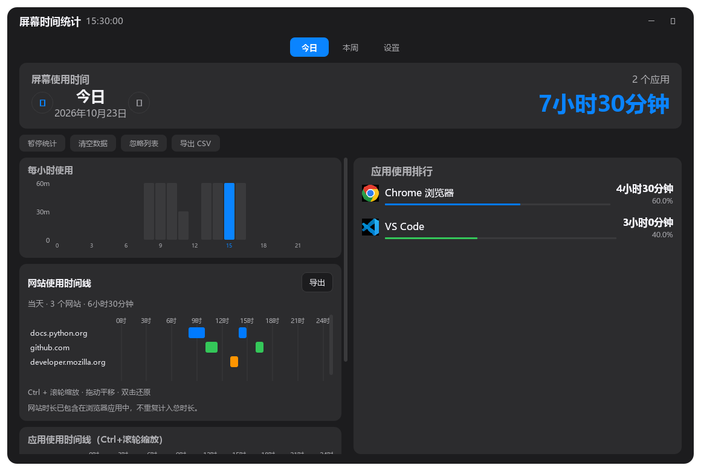
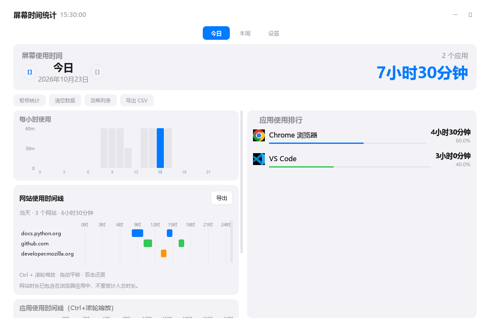
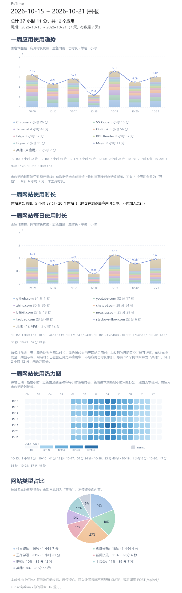
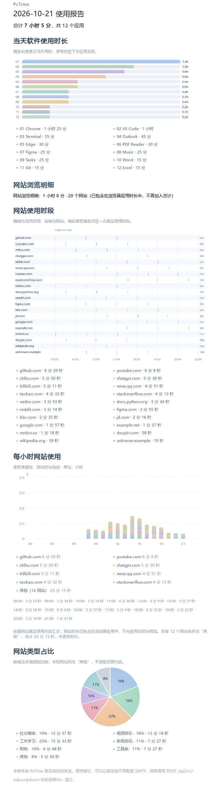

# PcTime

Windows 桌面屏幕使用时间统计工具，帮助你了解每天在各个应用上花费的时间。

客户端基于 [DABIAN-afk/usagetime](https://github.com/DABIAN-afk/usagetime) 重构扩展；
网站统计设计参考 [Planshit/Tai](https://github.com/Planshit/Tai)。
本项目仓库为 [sowidy/PcTime](https://github.com/sowidy/PcTime)，与两个上游项目独立维护。
新构建使用 `PcTime.exe`、`%APPDATA%\PcTime` 和 `PCTIME_*` 配置键。旧版的 `UsageTracker` 数据目录、`USAGETIME_*` 配置键及浏览器连接路径仍可兼容读取，升级不会自动搬迁数据库。
已有部署的数据库名与账号无需改名；只需让服务端配置继续指向原库，详见[升级说明](server/deploy/README.md#更新已有服务器)。
来源、许可证及尚待确认的许可事项见 [第三方声明](THIRD_PARTY_NOTICES.md)。


项目分两半，各自能独立工作：

- **客户端**（`client/`）—— PySide6 桌面程序，采集本机使用时长，打包成
  `PcTime.exe`。**不依赖服务端也能完整使用**。详见 **[client/README.md](client/README.md)**
- **服务端**（`server/`）—— FastAPI + MySQL，接收客户端上传的数据并按订阅发报告邮件。
  详见 **[server/README.md](server/README.md)**

## 功能特性

**客户端**（细节见 [client/README.md](client/README.md#功能特性)）

- **实时监控 / 智能休眠** — 每秒检测前台窗口精确计时，检测到无操作自动停止计时
- **今日 / 本周统计** — 24 小时柱状图 + 7 天趋势图
- **应用排行** — 按时长排序，支持自定义应用名映射、多进程合并统计
- **准确图标** — 优先生效程序文件里的图标，兼容快捷方式
- **防止重复计时** — 只允许一个实例运行
- **系统托盘 / 暂停恢复 / 忽略列表 / 开机自启**
- **自动导出** — 每天/每周/每月写成 CSV，按「年/月/日」分层存放
- **订阅每日报告** — 在设置里填邮箱，服务端据此发报告邮件

**服务端**（细节见 [server/README.md](server/README.md)）

- **数据接收** — 按「设备 + 日期」整块覆盖写入，重传不会让时长翻倍
- **每日 / 每周报告邮件** — 次日 00:03 发送前一天报告给订阅用户：报告日为周一~周六时是
  **当天**日报，周日换成**整周周报**。每天恒定一封，不重复发
- **漏发自愈** — 重启或漏发后自动补发前几天，靠数据库唯一键防止重复
- **管理接口** — 查设备、查发送记录、手工触发（dry_run 可先预览不真发）

**两边共有**

- **隐私保护** — 不采集键盘输入、不截屏；应用上传仅含应用名和时长，网站图表另需主动开启域名、每小时用量及起止时段上传，
  不含窗口标题、网页路径或搜索词。订阅邮箱只有在你主动填写并保存后才会发出去，不填就不发
  （详见[隐私声明](#隐私声明)）

## 运行与邮件预览

以下图片使用合成演示数据生成，不含真实使用记录或收件邮箱。点击邮件图片可查看大图。

### 客户端运行界面

应用排行与网站时间线直接显示在页面内，支持日期切换。



<details>
<summary>查看浅色界面</summary>



</details>

### 周报邮件

周报以柔色堆叠柱分别展示每天的软件与网站时长构成，并以折线标出网站每日总用时；以「日期 × 小时」热力图展示网站使用强度，
另有网站类型占比饼图；不再插入旧应用时间线。缺失日期留空，不当作零使用。
仅参考 ECharts 视觉风格：邮件图表由 Python 生成静态内嵌 PNG，不依赖 ECharts JS、Node.js 或浏览器。

[](server/docs/images/mail-weekly.png)

<details>
<summary>查看日报邮件</summary>

[](server/docs/images/mail-daily.png)

</details>

邮件图片由本项目 HTML 模板离线渲染，具体邮箱的字体与布局可能略有不同。

## 目录结构

```
PcTime/
├── client/    客户端（打包成 PcTime.exe）→ client/README.md
├── server/    FastAPI 服务端（部署到云服务器）  → server/README.md
└── tests/     两边共用的单元测试
```

两个目录**各自是一棵导入树的根**，包内一律用「以自己这个根为起点」的绝对导入，
不写相对导入（`from core.storage import ...` / `from db import users`）。
写错了不会报错，只会静默坏掉，所以两个目录的 README 里都单独讲了这件事。

`tests/` 里的引导代码（`tests/__init__.py`）把 `client/` 和 `server/` 都加进
`sys.path`（client 在前，避免两边同名模块互相遮蔽），所以一份测试代码能同时测两边。

## 快速开始

### 方式一：下载使用

本项目发行物以 [sowidy/PcTime Releases](https://github.com/sowidy/PcTime/releases) 为准。
如该页面提供 Windows 包，解压后运行 `PcTime.exe`，无需安装 Python 环境。
上游项目的发行包不包含本项目新增的同步、网站统计和邮件功能。

### 方式二：从源码运行

当前 Git 忽略规则将 `client/` 作为本地组件，仓库可只发布服务端；仅克隆仓库不一定
含客户端。服务端使用 [独立部署说明](server/deploy/README.md)，以下命令需另外具备
完整的 `client/` 源码。部署前验证可按服务端说明手工执行。

```bash
git clone https://github.com/sowidy/PcTime.git
cd PcTime
pip install -r client/requirements.txt
python client/main.py
```

（`.venv` 建在仓库根目录即可，`client/` 和 `server/` 都用它。）

### 方式三：自行打包

```bash
pip install -r client/requirements.txt
pip install pyinstaller

cd client
python tools/generate_icon.py
pyinstaller app.spec --clean
```

打包产物位于 `client/dist/PcTime/`，也可以直接双击 `client/build.bat` 一键完成。
打包注意事项见 [client/README.md](client/README.md#方式三自行打包)。

### 服务端

```bash
pip install -r server/requirements.txt
cd server
uvicorn app:app --host 0.0.0.0 --port 8000
```

建库、配置 `.env`、开放端口等完整步骤见 [server/README.md](server/README.md#部署)。

## 测试

```bash
.venv/Scripts/python.exe -m unittest discover -s tests -t . -v
.venv/Scripts/python.exe -m compileall -q client server tests
```

> 用仓库根目录那个 `.venv` 里的 Python。系统自带的 `python` 是 3.13 且没装
> `pymysql`，直接跑会在 `import db` 那一步就报 `ModuleNotFoundError`。

## 技术栈

| | 用到的 |
| --- | --- |
| **客户端** | PySide6 (Qt for Python) · SQLite (WAL) · psutil + Win32 API · 标准库 `urllib` · PyInstaller |
| **服务端** | FastAPI + uvicorn · MySQL 5.7/8（PyMySQL 驱动）· Pydantic v2 |

## 隐私声明

这一节描述的是**代码里的实际行为**，不是愿望。改动相关功能时必须同步改这里，
以及界面「设置 → 隐私与安全」里那段说明 —— 它在运行时按状态改文案：上传那一行
跟着上传开关走，邮箱那一行跟着订阅状态走（见 `dashboard._privacy_mail_line`）。

**本机的数据：**

- 数据存在本地 SQLite 数据库里（源码模式在 `client/usage.db`，打包模式在
  `%APPDATA%\PcTime\usage.db`），随时可删
- 采集的内容是「哪个应用在什么时候用了多久」，来自前台窗口句柄和进程名
- **不**记录键盘输入内容
- **不**截取屏幕
- 窗口标题默认**不**保存；用户在首次引导里主动开启「记录窗口标题」后才会写入本地库
- 订阅邮箱（如果你填了）存在本地设置表里，和上面那些数据放在同一个库

**会发出去的请求：**

1. **每日上传**（`client/net/uploader.py`）。默认开启，可在设置页关掉。
   发出去的字段**仅限**：设备 ID、主机名、操作系统、客户端版本、可选的订阅邮箱、
   以及每天的「应用名 / 显示名 / 使用秒数 / 启动次数」。
   **不含**窗口标题、exe 完整路径、文档名、网址等任何内容信息，也不含用户名。
   邮箱字段**只有在你订阅了每日邮件时才有值**，否则是 null —— 光填了邮箱没勾订阅，
   邮箱不会跟着使用记录一起出去。
2. **保存订阅设置**。您主动点「保存」时发一次
   `POST /api/v1/subscription/{设备ID}`，只带 `email` 和 `subscribed` 两个字段。
   如果这一次没成功（断网，或者服务端还没有这台设备的记录），会在**下一次上传
   成功之后**自动补发一次 —— 这是「本地优先」的代价：设置先存在本机，同步可以
   迟到。没有待同步的内容时不会多发这个请求。
3. **「测试连接」按钮**。只在用户主动点击时发一次 `GET /api/v1/health`，不带任何数据。
4. **可选网站图表上传**。开启“邮件中加入网站图表”并启用自动上传后，会向服务端发送
   网站域名、每日时长、每小时用量及访问起止时段；不发送完整网址、页面标题和搜索词。
   应用时间线是另一项独立的可选上传设置，仅包含应用名、15 分钟时段和用量。

关掉「自动上传」后，程序不会主动发出任何网络请求 —— 只剩下手动点「立即上传」
「保存订阅」或「测试连接」这几条路。

**服务端：** 数据存在自建的 MySQL 里，不会转给第三方。网站与时间线接口使用设备 Bearer 凭据；
旧版基础接口仍使用设备 ID 作为访问凭据，因此设备 ID 和令牌都不应分享。

服务端**自己**配了邮件推送时，会把你上传的「应用名 + 当日时长」汇总成一封信发到
你订阅时填的邮箱。发件走的是你自己配置的 SMTP 账号（QQ / 163 / 自建都行），不经
任何第三方分析服务；不配 SMTP 就没有这回事。细节见
[server/README.md 的「邮件报告」](server/README.md#邮件报告)。

**还没有做的（不要以为已经有了）：** 传输加密（目前是明文 HTTP）、真正的账号体系
（现在是设备 ID 直连，没有注册/登录/找回）。

## License

本项目新增贡献使用 [MIT License](LICENSE)。上游来源、原始版权和第三方依赖许可见
[NOTICE](NOTICE)、[THIRD_PARTY_NOTICES.md](THIRD_PARTY_NOTICES.md) 和 [licenses/](licenses/)。
`DABIAN-afk/usagetime` 的 README 声明 MIT，但完整上游许可记录仍待补齐；
Qt 等依赖另有许可要求，不能把整套二进制依赖统一视为 MIT。
